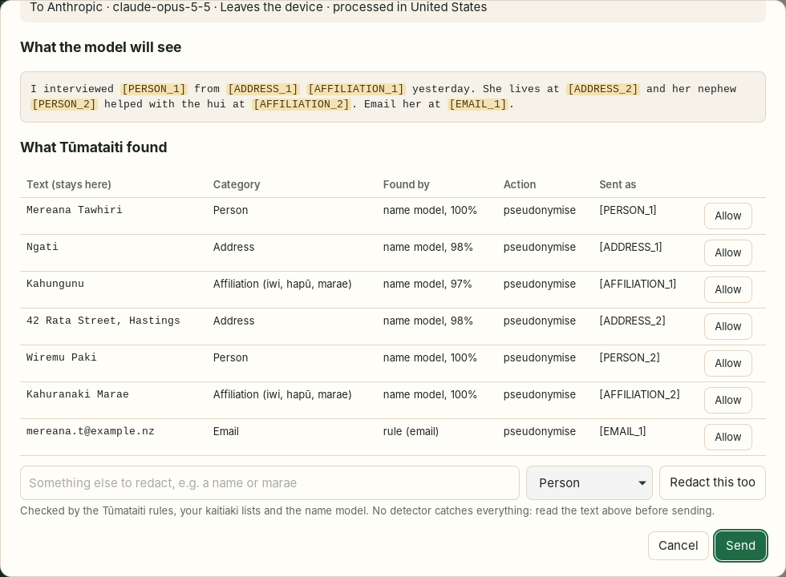

# Pātaka

A desktop AI chat client for macOS, Windows and Linux, grounded in Māori data sovereignty. Talk to Claude, ChatGPT, DeepSeek, Qwen, Mistral or a model running on your own computer (Ollama, LM Studio), with an API key or with the Claude or ChatGPT subscription you already have. Before anything reaches a cloud model, [Tūmataiti](https://github.com/woodRock/tumataiti) redacts personal and culturally sensitive details **on your device**. Replies are restored locally, so you read a natural answer while the provider only ever sees placeholders.

Built with Rust and [Tauri 2](https://tauri.app). The window is plain HTML, CSS and JavaScript with no runtime npm dependencies.



## What it does

- **Use it with Claude Code in the terminal.** `pataka claude` runs the real Claude Code with the Tūmataiti proxy in the middle: same Claude Code, same arguments, but only redacted text reaches Anthropic. See [Use Pātaka with Claude Code](#use-pātaka-with-claude-code).
- **An agent in your project, like Claude Code or T3 Code.** Start **+ Agent in a folder** and the agent reads and edits files, runs commands and fixes bugs there, using Claude Code with your Claude subscription or Anthropic API key. Unlike running Claude Code directly, every request it makes to the model passes through a **Tūmataiti proxy on your computer**: your messages, file contents, command output and its own earlier tool calls are redacted first, and the placeholders are filled back in on your computer before any tool runs. You approve commands and file changes in Pātaka. Tapu content stops the request, and network and MCP tools never receive real values.
- **Use your subscription, or an API key.** Like [T3 Code](https://github.com/pingdotgg/t3code), Pātaka can run the official Claude Code and Codex apps you are already signed in to, so a Claude Pro/Max or ChatGPT plan works without an API key. Pātaka never sees that login. It sends the apps only Tūmataiti-redacted text and runs them locked down for chat: Claude Code with no tools, MCP servers, settings or saved sessions, and Codex in a read-only sandbox that Pātaka stops if Codex tries to act on the computer.
- **Local redaction with Tūmataiti, rules and model.** The Tūmataiti rules find IRD numbers (mod-11 checked), NHI numbers, bank accounts, payment cards (Luhn checked), passports and driver licences, NZ phone numbers, emails, URLs, IP addresses, labelled dates of birth or death, and API keys or passwords. The **Tūmataiti name model** (DeBERTa-v3-small, fine-tuned on NZ and te reo Māori text) finds people's names, addresses and affiliation (iwi, hapū, marae) in context. It runs natively on your device through ONNX Runtime. **Kaitiaki lists** that you or your data steward maintain add names, places and tapu terms. Everything is merged by Tūmataiti's own review and merge steps. Each item is pseudonymised (`[PERSON_1]`), generalised (`[YEAR 1984]`), masked (`[NZ_GOV_ID]`) or blocked, per a policy you control.
- **Consistent placeholders across a kōrero.** The same person keeps the same placeholder across every turn. When a message goes to the cloud, the whole history is redacted again under the current policy, so a term added later also protects earlier turns.
- **Review before sending.** See exactly what the model will receive, with each placeholder highlighted. You can add something else to redact, or allow a term through, before you send.
- **Tapu and noa kōrero.** Mark a conversation *tapu* and Pātaka will only send it to a model on this device or on infrastructure you have marked *sovereign*. Pātaka works out "on this device" from the address; a remote server cannot claim it.
- **Where your data goes.** Every provider shows where it processes data. Every message records which provider and model handled it, and what left your device.
- **Encrypted at rest.** All kōrero, settings, API keys and placeholder mappings are encrypted with XChaCha20-Poly1305. The key is protected by your passphrase (Argon2id) or the OS keychain. There is no account, telemetry, analytics or sync.
- **Tamper-evident audit log.** A hash-chained record of what *kinds* of data went where and under which policy. It holds counts only, never text or placeholder values.
- **Yours to take or delete.** Export any kōrero as Markdown or JSON, set automatic deletion after N days, or delete everything (including the key) in one step.

See [docs/SOVEREIGNTY.md](docs/SOVEREIGNTY.md) for how this maps to the Te Mana Raraunga and CARE principles, and [SECURITY.md](SECURITY.md) for the security design and threat model.

## Install

Download the installer for your platform. The links fetch the files committed in [`release/`](release/), with checksums in [`release/SHA256SUMS`](https://github.com/woodRock/Pataka/raw/main/release/SHA256SUMS).

| Platform | Download | Notes |
|---|---|---|
| Windows 10/11 | [Pataka_0.5.0_x64-setup.exe](https://github.com/woodRock/Pataka/raw/main/release/windows/Pataka_0.5.0_x64-setup.exe) | Installs for the current user. Unsigned, so SmartScreen may warn: choose *More info → Run anyway*. |
| Linux (Debian, Ubuntu) | [Pataka_0.5.0_amd64.deb](https://github.com/woodRock/Pataka/raw/main/release/linux/Pataka_0.5.0_amd64.deb) | `sudo apt install ./Pataka_0.5.0_amd64.deb` |
| Linux (Fedora, openSUSE) | [Pataka-0.5.0-1.x86_64.rpm](https://github.com/woodRock/Pataka/raw/main/release/linux/Pataka-0.5.0-1.x86_64.rpm) | `sudo dnf install ./Pataka-0.5.0-1.x86_64.rpm` |
| Linux (any) | [Pataka_0.5.0_amd64.AppImage](https://github.com/woodRock/Pataka/raw/main/release/linux/Pataka_0.5.0_amd64.AppImage) | `chmod +x` it and run |
| macOS 13+ (Apple silicon and Intel) | [Pataka_0.5.0_universal.dmg](https://github.com/woodRock/Pataka/raw/main/release/macos/Pataka_0.5.0_universal.dmg) | Open the disk image and drag Pātaka to Applications. Not notarised: the first time, right-click the app and choose *Open* (on macOS 15+, use *System Settings → Privacy & Security → Open Anyway*). |

Check a download before installing:

```bash
sha256sum -c SHA256SUMS --ignore-missing     # Linux
shasum -a 256 -c SHA256SUMS --ignore-missing # macOS
```

### Just the `pataka` command (Claude Code in the terminal)

```bash
curl -fsSL https://raw.githubusercontent.com/woodRock/Pataka/main/install.sh | sh     # macOS, Linux
```

```powershell
irm https://raw.githubusercontent.com/woodRock/Pataka/main/install.ps1 | iex          # Windows
```

These download `pataka` from [`release/cli/`](release/cli/), check its SHA-256 against `release/SHA256SUMS`, and install it for your user only. The app installs the same command from **Settings → Claude Code**.

### How the installers are built

- **Linux and Windows** are built locally with `scripts/build-linux.sh` and `scripts/build-windows.sh`, then committed to [`release/`](release/).
- **macOS** has to be built on a Mac. The committed `.dmg` was built with `scripts/build-macos.sh` and committed to `release/macos/`. Alternatively, use the [macOS build](.github/workflows/macos.yml) workflow (**Actions → macOS build → Run workflow**). With *publish* ticked, the workflow creates the GitHub Release `v<version>` with the macOS `.dmg` and the Linux and Windows installers from `release/`. GitHub Actions only runs while the account has no billing lock: a locked account cannot start jobs, even free ones on public repositories.

## Getting started

1. Open Pātaka and choose how to protect your data: a **passphrase** (recommended) or the **OS keychain**.
2. Choose **Connect a model** (in **Settings → Providers**, or at the end of the model menu) and pick one:
   - **On this device:** start [Ollama](https://ollama.com) or LM Studio first; Pātaka lists its models.
   - **Your subscription:** install [Claude Code](https://claude.com/claude-code) or [Codex](https://developers.openai.com/codex/cli) and sign in once in a terminal (`claude auth login` or `codex login`). Pātaka finds the app and checks you are signed in.
   - **API key:** paste a key. It is stored encrypted and never shown again.
3. Open **Settings → Tūmataiti** and press **Install** under *Name model*. This is a one-time download of about 170 MB (250 MB on Windows): the model from Hugging Face and ONNX Runtime from Microsoft's GitHub release. Every file is checked against a SHA-256 built into Pātaka.
4. Open **Settings → Kaitiaki lists** and add the names, marae, hapū, places and tapu terms that should always be protected, whatever the model finds.
5. Start a **Kōrero hou** (general) or a **Tapu** kōrero (on-device or sovereign models only).

## Build it yourself

You need [Rust](https://rustup.rs) and Node.js 20 or later (npm is only used to fetch the Tauri CLI).

```bash
npm ci
npx tauri dev          # run in development
scripts/check.sh       # fmt, clippy, tests, cargo audit/deny if installed, UI safety checks
```

Release builds:

| Target | Run on | Command |
|---|---|---|
| Linux .deb / .rpm / .AppImage | Linux | `scripts/build-linux.sh` |
| Windows NSIS installer | Linux (cross-compiled) | `scripts/build-windows.sh` |
| Windows NSIS + MSI | Windows | `powershell scripts/build-windows.ps1` |
| macOS universal .dmg | macOS, or GitHub Actions (*macOS build*) | `scripts/build-macos.sh` |

Each script copies its output into `release/<platform>/` and refreshes `release/SHA256SUMS`. Commit the result to publish it. Linux build dependencies are listed at the top of `scripts/build-linux.sh`.

Linux and Windows have no CI, so run `scripts/install-hooks.sh` once. It adds a git pre-push hook that runs `scripts/check.sh` before every push. (The macOS workflow runs the same checks before it builds.)

## Use Pātaka with Claude Code

```bash
pataka setup          # once: protection, name model, hooks, and a redaction self-test
pataka claude         # in a project folder, instead of `claude`
```

Claude Code works exactly as usual, and every argument passes through. Pātaka starts its Tūmataiti proxy on 127.0.0.1, behind a secret path, and points Claude Code at it with telemetry switched off. Every request is redacted on the way out (prompts, file contents, command output, Claude Code's own instructions), and placeholders are filled back in on the way back. Optional hooks refuse prompts containing tapu terms or secrets, and ask before commands that send data out (`curl`, `scp`, `git push`…) or reach outside the project. Lists, the name model and the audit log are managed from the terminal too (`pataka lists add-person "Hēmi Te Rangi"`, `pataka model install`, `pataka audit verify`), and are shared with the app.

Claude Code keeps its own transcripts in `~/.claude`, with real values, on your computer; only redacted text reaches Anthropic. Full details: [docs/CLAUDE-CODE.md](docs/CLAUDE-CODE.md).

## Agents

An agent kōrero runs Claude Code in the folder you choose, the way T3 Code drives it, with Pātaka in the middle:

```
 you ── Pātaka ── Claude Code (in your folder) ── Tūmataiti proxy (127.0.0.1) ── Anthropic
                       ▲  tools run here,              redacts every request,
                       │  with real values             restores every reply
                       └── approvals in Pātaka
```

- **What leaves your computer:** only redacted text. The proxy redacts the system prompt (with your account name in paths replaced), your messages, file contents and command output in tool results, and the arguments of earlier tool calls. Images and PDFs are withheld, because they cannot be checked. Secrets the agent reads, such as an API key in a `.env` file, are masked. Tapu terms stop the request.
- **What comes back:** placeholders are restored in the reply and in the arguments of tools that act only on your computer (Bash, Read, Write, Edit, Grep, Glob and the like), so files get the real names. Web fetches, MCP tools and unknown tools keep their placeholders.
- **Approvals:** *Ask before acting* (default), *Allow file edits, ask for commands*, *Plan only*, or *Auto* (opt-in per kōrero, after a one-time confirmation). In every mode, Pātaka's guards still ask before commands that send data off the computer or reach outside the folder, web fetches and MCP tools; every tool call is shown and recorded in the audit log; Stop always works. Bypassing permissions is not offered. Each request shows the exact command or diff, with real values, and *Always allow* lasts only for that session.
- **Claude Code's own background traffic** (telemetry, error reports, update checks) is switched off for agent sessions.

Limits:
- Claude Code keeps its own session history on your computer (in `~/.claude/projects`), unencrypted and with real values. That is the same as using Claude Code directly, and it stays on your computer.
- Hooks and MCP servers configured in your Claude Code settings still run. Their own network traffic does not pass through Pātaka, though they never receive values restored by Pātaka.
- A command you approve runs with real values. A command that uses the network, such as `curl`, could send them somewhere, so read commands before allowing them.
- Codex is not yet available as an agent engine. Its sign-in and API need a different proxy.

## Layout

```
crates/pataka-core/   the engine, shared by the app and the pataka command:
                      redaction, vault and store, kaupapa, name model, audit log,
                      guards, providers, and the agent proxy (agent_proxy/)
crates/pataka-cli/    the pataka command (pataka claude, proxy, setup, lists, model, audit, hooks)
install.sh, install.ps1  one-line installers for the pataka command
src-tauri/src/
  redaction.rs     Tūmataiti rules + name model + kaitiaki lists, persistent placeholder vault, restore
  student.rs       Tūmataiti name model: tokenising, ONNX Runtime inference, span decoding (pinned hashes)
  model_install.rs one-time, hash-verified download of the model and ONNX Runtime
  sovereignty.rs   on-device / sovereign / offshore rules, tapu routing, URL checks
  crypto.rs        XChaCha20-Poly1305 and Argon2id
  store.rs         encrypted files, keychain or passphrase key, secure delete
  audit.rs         hash-chained audit log
  providers/       Anthropic and OpenAI-compatible streaming clients (the only network code),
                   and cli.rs, which runs the signed-in Claude Code or Codex app for subscriptions
  commands.rs      what the window may call
  agent.rs         agent kōrero: runs Claude Code in a folder, relays tools and approvals
  agent_proxy/     the Tūmataiti proxy agents talk through (redact out, restore in)
ui/                window: index.html, styles.css, app.js, markdown.js (safe, DOM-only renderer)
scripts/           build, checksum, check and hook scripts
release/           committed Linux and Windows installers and SHA256SUMS
.github/workflows/ macOS build on a GitHub-hosted Mac, publishes the GitHub Release
```

## Limits

Redaction reduces risk; it does not remove it.

- No detector catches everything. Tūmataiti's own evaluation finds that rules plus a student model still miss personal information in some held-out NZ documents (see its [results](https://github.com/woodRock/tumataiti/tree/main/ml/results)). Always read the outbound text in the review step.
- Without the name model installed (or on Intel Macs, which ONNX Runtime 1.31 has no build for), **names, addresses and whakapapa are only caught if they are on a kaitiaki list** or added in the review step.
- A model can sometimes infer who someone is from context alone.
- Once text reaches a provider, its own terms decide what happens to it.

## Licence

Apache 2.0. Tūmataiti is also Apache 2.0.
